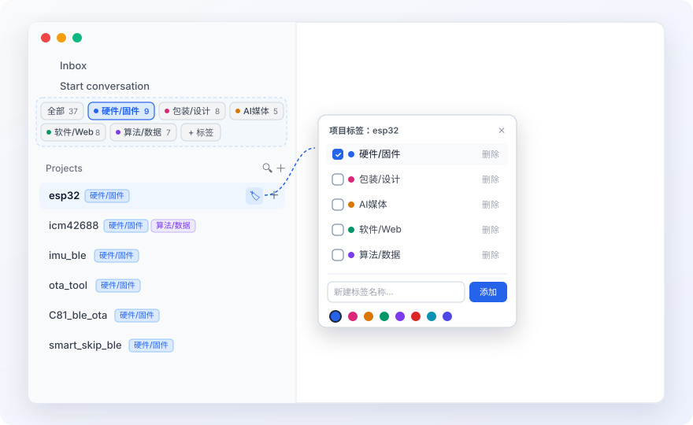

# Antigravity Sidebar Tags (`antigravity-sidebar-tags`)

<p align="center">  
    
</p>

<p align="center">  
  <strong>为 Google Antigravity 左侧项目栏增加「多标签分类导航 & 一键过滤」能力的轻量增强插件</strong>  
  
  零修改 <code>app.asar</code> · 不破坏 macOS 应用签名 · 无需重启热注入 · 原生兼容虚拟滚动列表  
</p>

---

## 💡 为什么做这个工具？（痛点背景）

当你在 **Google Antigravity** 中积累了二三十个甚至更多项目（例如同时包含 **硬件固件、包装设计、AI 视频、Web 前后端、算法脚本** 等不同领域的工程）时，原生左侧栏把所有项目平铺在同一个 `Projects` 列表里：

- 找项目需要反复上下滚动或者记住项目名搜索；
- 不同领域的项目混在一起，缺少按标签归类与一键聚焦视图。

同时，Antigravity 客户端在 macOS 上开启了严格的 **`ElectronAsarIntegrity`（SHA256 签名校验）**，直接解包修改 `/Applications/Antigravity.app/Contents/Resources/app.asar` 会导致客户端签名失效并直接崩溃。

**`antigravity-sidebar-tags`** 采用了一种**零侵入**方案：利用 Antigravity 内置开启的本地 `DevToolsActivePort`（CDP 通道）动态注入标签栏并直接接管 React 底层的 `richProjectsProvider` 数据源，在**完全不触碰安装包任何字节**的前提下实现丝滑的左侧栏标签导航。

---

## ✨ 核心功能

- 🏷️ **顶部标签导航栏**：在左侧栏 `Projects` 上方自动渲染紧凑的标签胶囊栏（`全部`、自定义彩色标签、`未分类`、`+ 标签`），实时显示每个分类下的项目数量。
- ⚡ **一键无损过滤**：点击任意标签胶囊，左侧栏立即只显示该标签下的项目及其子对话；再次点击当前高亮标签（或点击 `全部`）即可恢复显示所有项目。
- 🎨 **支持多标签 & 8 种预设配色**：每个项目可绑定一个或多个标签，项目名称右侧自动显示彩色小徽章。
- 🪄 **随手打标交互**：
  - 点击项目标题右侧的 **彩色标签徽章**，或鼠标悬停在项目行上点击右侧的 **🏷️ 标签图标**，即可弹出标签勾选面板；
  - 在弹窗内支持**一键勾选/取消标签**、**输入名称并选色新建标签**、**删除旧标签**。
- 📂 **当前项目 Files 文件浏览框**：
  - 在左侧栏 `Projects` 列表下方内置可拖拽高度、可折叠的 **Files 文件树浏览框**，自动跟随当前正在聊天的对话或选中的项目切换目录；
  - **单击文件夹**：展开/收起子目录；
  - **双击文件**：直接调用 macOS / 系统默认关联程序打开该文件（如用 Preview 打开图片/PDF、Excel 打开表格、VS Code 打开代码等）；
  - **右键菜单**：支持 **「在 Finder 中显示」**、**「用系统默认程序打开」**、**「复制完整路径 / 相对路径」**。
- 🥧 **AGY ↔ Pi 双引擎切换与第三方模型接管（新增）**：
  - 在底部聊天输入框的模型选择器旁注入 **`[⚡ AGY | 🥧 Pi]`** 双引擎切换开关；
  - 切换到 **`🥧 Pi`** 后，可直接下拉选择本机 `~/.pi/agent/models.json` 中配置的任意第三方模型（如 `claude-haiku-5.5`、`claude-sonnet-5.5`、`claude-opus-5.5`、`deepseek-v4.1-flash`、`glm-5.3-flash`、`qwen3.8-max`、`grok-4.7` 等）；
  - **共享项目目录**：`Pi` 自动在当前聊天所属项目的本地文件夹下工作（拥有完整的 `read`、`bash`、`edit`、`write` 能力），文件修改后自动刷新左侧 `Files` 树；
  - **双向共享对话上下文**：调用 `Pi` 时自动读取当前会话的 `transcript.jsonl` 历史同步给 `Pi`；切回 `⚡ AGY` 发送消息时，自动将刚才 `Pi` 的操作记录（`pi_shared_context.md`）同步给 `AGY`，实现无缝接力。
- 💾 **三重持久化存储**：所有标签及绑定关系实时同步至本地文件 `~/.gemini/antigravity/project_tags.json`、`nativeStorage` 与 `localStorage`，客户端重启或升级版本均不会丢失。
- 🔄 **后台无感守护**：通过 macOS `LaunchAgent`（或 Linux `systemd`）在后台轻量运行，打开新窗口或刷新页面时自动完成注入。

---

## 🚀 一键安装

> **前置要求**：系统已安装 **Node.js >= 18**（用于提供原生 `WebSocket` 与 `fetch` 支持）。

### 方式一：单行命令一键安装（macOS / Linux）

打开终端运行以下命令，无需重启正在运行的 Antigravity，左侧栏会**立即生效**：

```bash
curl -fsSL https://raw.githubusercontent.com/willwill85/antigravity-sidebar-tags/main/install.sh | bash
```

### 方式二：克隆仓库安装

```bash
git clone https://github.com/willwill85/antigravity-sidebar-tags.git
cd antigravity-sidebar-tags
node bin/cli.js install
```

---

## 📖 使用指南

1. **按标签筛选项目**：
   - 点击左侧栏 `Projects` 上方的任意标签胶囊（如 `硬件/固件`、`软件/Web`），项目列表会立即过滤，只保留包含该标签的项目。
   - 再次点击已选中的标签，或点击 `全部`，即可恢复完整列表。
   - 若有尚未打标的新项目，顶部会自动出现 `未分类` 胶囊，方便快速找出并归类。
2. **给项目打标签 / 修改标签**：
   - 将鼠标悬停在左侧栏任意项目名称上，点击右侧出现的 **🏷️ 图标**（或直接点击已有的彩色标签徽章）。
   - 在弹出的面板中勾选或取消勾选标签，列表与徽章会实时更新。
3. **新建或删除标签**：
   - 点击标签栏末尾的 **`+ 标签`** 按钮（或在任意项目的标签弹窗底部），输入标签名称、点选下方圆点颜色，按回车或点击 **添加** 即可。

---

## 🛠️ CLI 命令一览

安装后你可以使用内置 CLI 管理插件状态：

```bash
# 安装后台自启守护进程，并立即注入当前打开的所有 Antigravity 窗口
node bin/cli.js install

# 仅对当前已打开的窗口执行一次即时注入（不安装后台服务）
node bin/cli.js inject

# 查看当前 Antigravity CDP 端口状态、已打开窗口数及配置文件路径
node bin/cli.js status

# 卸载后台服务，并立即从当前打开的窗口中移除标签栏、恢复原始列表（保留标签配置文件）
node bin/cli.js uninstall
```

---

## 📂 配置文件格式（支持手动编辑与备份）

所有标签配置默认保存在 `~/.gemini/antigravity/project_tags.json`（也可通过环境变量 `AGY_TAGS_CONFIG` 指定路径）。你可以随时备份该文件，或者直接用编辑器批量修改：

```json
{
  "version": 1,
  "activeTag": "all",
  "tags": [
    { "id": "hardware", "name": "硬件/固件", "color": "#2563eb" },
    { "id": "design",   "name": "包装/设计", "color": "#db2777" },
    { "id": "media",    "name": "AI媒体",    "color": "#d97706" },
    { "id": "software", "name": "软件/Web",  "color": "#059669" },
    { "id": "data",     "name": "算法/数据", "color": "#7c3aed" }
  ],
  "projectTags": {
    "a300bfcb-bf64-480b-a671-f024542f01d1": ["hardware"],
    "c7f7a387-12ab-4ea1-b95e-a1030b8dfbd4": ["software", "data"]
  }
}
```

---

## 🔍 技术实现原理（How It Works）

1. **为什么不用解包 `app.asar`？**  
   Antigravity 的 `Info.plist` 中包含 `ElectronAsarIntegrity` 哈希校验，直接改动 `app.asar` 会触发 macOS Gatekeeper / Electron 完整性保护导致进程闪退。但 Antigravity 主进程（`dist/main.js`）启动时默认附加了 `--remote-debugging-port=0`，并将随机分配的调试端口写入 `<userData>/DevToolsActivePort`：
   - **macOS**: `~/Library/Application Support/Antigravity/DevToolsActivePort`
   - **Linux**: `~/.config/Antigravity/DevToolsActivePort`
   - **Windows**: `%APPDATA%\Antigravity\DevToolsActivePort`
   本工具的守护进程（[`src/daemon.js`](./src/daemon.js)）读取该端口并通过本地 WebSocket 执行 `Page.addScriptToEvaluateOnNewDocument` 与 `Runtime.evaluate`，实现完全免改包的热注入。
2. **为什么不用 CSS `display: none` 隐藏项目？**  
   Antigravity 左侧栏使用了 `@tanstack/react-virtual` 虚拟滚动列表（固定计算每个项目头 `36px`、每个子会话 `49px` 的绝对偏移量）。如果单纯用 DOM/CSS 隐藏不匹配的项目，会导致虚拟列表留下大片空白断层，且展开状态下的子对话依然会残留。  
   [`src/inject.js`](./src/inject.js) 通过 `[data-testid="conversation-list-sidebar"]` 节点的 `__reactFiber$` 向上回溯找到 `projectManagementFeature.richProjectsProvider`，在内存态对非当前标签的项目附加合成的 `_tagFiltered: true` 标记，并拦截 `updateProject` 防止触发任何真实的归档 RPC。这样 React 原生的 `fsb()` 与 `Asb()` Hooks 会自动完成项目及子对话的过滤，虚拟滚动高度也会被精准重算，体验与原生功能完全一致。

---

## 📄 License

[MIT License](./LICENSE)
